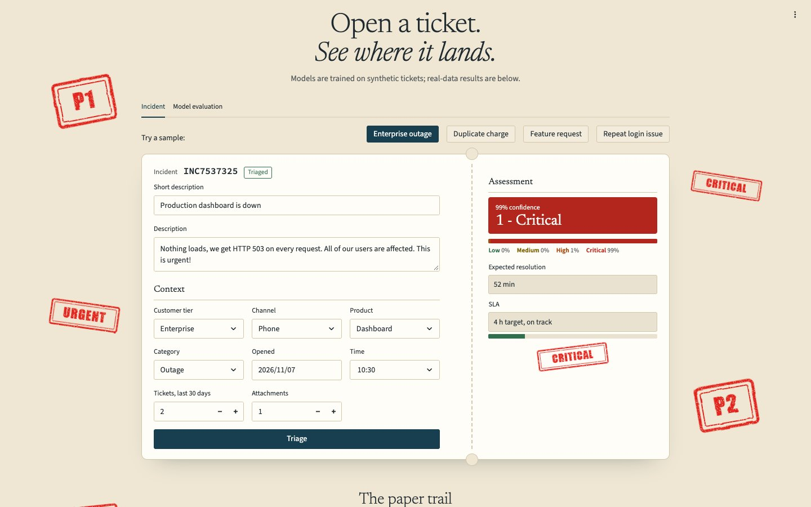
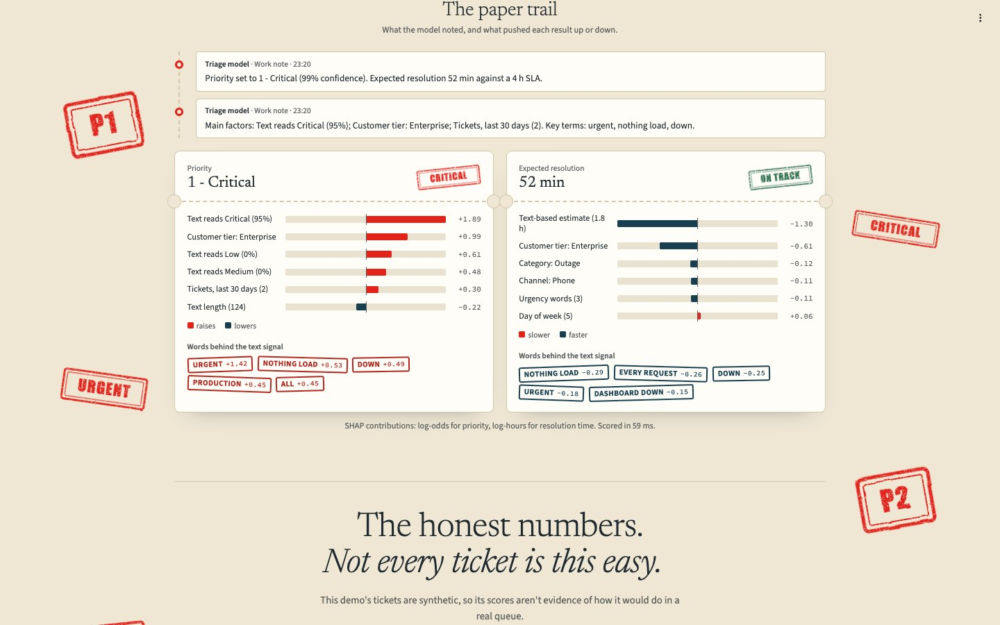

# Support Ticket Triage

A ticket arrives. How urgent is it, and how long might it take to resolve? This project is a triage model that estimates both from the ticket text and details such as its channel and product, then shows which inputs influenced each prediction. It also includes a forward-in-time evaluation of the pipeline on real Apache Jira bug reports, which comes first below, including where the models lose to simple baselines. The demo uses synthetic tickets.

**[Live demo → richithareddyy-ticket-triage.streamlit.app](https://richithareddyy-ticket-triage.streamlit.app)** (synthetic tickets)

Python, scikit-learn, XGBoost, SHAP, NLTK, Flask, Streamlit, PySpark, Docker.

## Main result: Real-data check

To test the pipeline on real data, it runs on **96,086 bug reports** from the public Apache Jira tracker (Hive, Spark, Kafka, HBase, HDFS, YARN, Flink, Cassandra), of which 93,519 were still open 15 minutes after filing. Only those are used. The models train on earlier bugs and are tested on the 25,856 filed from 2020 to 2025; bugs filed in 2026 are not used.

Averages over the six test years, each weighted equally. Text only is a TF-IDF linear model; metadata only is the chosen model family without text:

| Metric | Model | Majority / median | Text only | Metadata only |
| --- | --- | --- | --- | --- |
| Priority macro-F1 | **0.333** | 0.214 | 0.296 | 0.297 |
| Priority accuracy | 71.5% | **74.6%** | 71.7% | 46.8% |
| Resolution MAE | 867 h | 916 h | **867 h** | 897 h |
| Resolution median error | 508 h | **374 h** | 520 h | 491 h |

Priority has a modest, real signal. The model beats every simple baseline on macro-F1 in five of six years (0.33–0.36 against at most 0.31), but not in 2025 (0.266 against 0.298), and its accuracy is below always answering Medium. Resolution time is not useful: on MAE the full model is no better than the text-only model (it beats every baseline in three of six years), and its median error is worse than predicting the median. Its median error is lower than the text-only model's (508 against 520 hours).

In plain terms, always guessing the majority class gets higher priority accuracy than the model (74.6% against 71.5%). The resolution-time model does not beat the text-only baseline on MAE (867 hours each), and while it beats the median baseline on MAE (867 against 916 hours), it loses to it on median error (508 against 374 hours).

These are bug reports, not customer-support tickets. Jira has no customer tier or channel, so those fields are `unknown`. The population is issues whose type is Bug today, minus any that became Bugs more than 15 minutes after filing, 245 dated before 2005 (including impossible dates) and 29 whose priority 14 days after filing has no match among the four levels; issues filed as bugs and later re-typed are missing. Per-year results are in the [rolling metrics](artifacts/jira_temporal/metrics.json); `make jira train-jira` downloads the tracker again and reruns the evaluation; the results come from a snapshot taken on 2026-11-16 that is not in the repository, so a new download will not match them exactly. The hosted demo still uses the synthetic model.

### How it was evaluated

This is a forward-in-time evaluation with inputs rebuilt as filed, apart from the exceptions listed under Inputs:

- **Inputs** are the summary, description, component and attachments as they stood 15 minutes after filing, rebuilt from each issue's changelog, plus project, filing time and the reporter's bug count in this dataset over the previous 30 days. Descriptions are cut to 4,000 characters, and a bug with several components keeps only the first by name. Two inputs are not rebuilt: project and reporter are the current values, so 648 bugs that later moved project and 1,207 whose reporter later changed may not match what was filed.
- **Priority** is the value 14 days after filing (5.4% changed in that time). **Resolution time** is hours to first resolution, capped at 90 days (for 23 bugs with no resolution in the changelog, the current resolution date is used); a bug still open at the cap is labelled 90 days, never zero. Every outcome is kept: fixed, won't-fix, duplicate and never resolved (16.8%).
- **Each year from 2019 to 2025 is predicted by models trained on bugs whose outcomes had settled before that year began.** A bug filed in late November only counts as settled for resolution time in late February, even if it closed the next day, so it misses the next January's models.
- **Text scores inside the stacked model are also forward-only.** Training rows are cut into five chronological blocks, and each block is scored by a text model fit only on outcomes settled before it. The first block trains the text model but is left out of the final model.
- **2019 picks the model family** (Random Forest for priority, XGBoost for resolution time); 2020–2025 test it unchanged. In 2019 itself, the text-only baseline had a higher priority macro-F1 than the chosen Random Forest (0.3215 against 0.3098).

For the last year's models, on 300 sampled 2025 bugs, the input with the largest mean absolute SHAP value is the project for both tasks and the second is a text score; grouped SHAP values sum to the model output to within 1e-5. The pandas feature code is the same as for the synthetic tickets. The Spark/pandas parity test checks that code on synthetic tickets only.

### Correction and earlier result

**Correction:** components removed within 15 minutes of filing were counted as present; fixing that changed the category on 137 of 96,086 bugs and moved average priority macro-F1 from 0.332 to 0.333 and resolution MAE by 0.2 hours, with no change to the conclusions.

**Earlier result, kept for the record.** A first version tested on 50,855 fixed bugs with a single 70/15/15 split by filing date and reported priority macro-F1 0.360 and resolution MAE 1,005 hours ([metrics](artifacts/jira/metrics.json)). It is not comparable to the table above. It used only fixed bugs, labelled current priorities and last resolution dates, used later field values as inputs, counted training outcomes that weren't known at the test cutoff, and shuffled the inner stacking folds. Its population, targets and test period also differ.

## Demo on generated data

[](https://richithareddyy-ticket-triage.streamlit.app)

Pick a sample ticket or write your own, then press **Triage**. The ticket is stamped with a priority, an expected resolution time, and its SLA status:



The paper trail lists the main factors behind each prediction as SHAP contributions, plus the words that drove the text scores:



The **Model evaluation** tab shows the synthetic metrics and the Jira results.

The hosted app may take up to a minute to wake if nobody has opened it recently.

The first version, which predates this repository's history, represented text with 3,000 TF-IDF features. Its SHAP explanations often pointed to missing words: “the word *would* isn’t in this ticket.” That wasn’t useful. Now a small text model turns the message into a few scores, which XGBoost combines with the other ticket details. During training, each score comes from a model that did not train on that ticket. So a ticket's own label never trains the model that scores its text.

### Synthetic results

Training and evaluation use **20,000 synthetic tickets**, split into 14,000 training, 3,000 validation, and 3,000 test examples. The final XGBoost models report:

| Task | Test result | Baseline |
| --- | --- | --- |
| Priority | Macro-F1 0.705 | Majority class: 0.130 |
| Resolution time | MAE 12.2 hours | Median: 24.4 hours |

These results describe the generated dataset, not performance on a real support queue. [Committed metrics](artifacts/metrics.json) contain the candidate comparisons and final results. SHAP shows how inputs influenced the model’s prediction; it does not show what caused a ticket to take longer.

The results above are the easy case: the models are learning rules that were written into the data generator.

## Run locally

Requires Python 3.9–3.12 (the pinned NumPy has no prebuilt wheels for 3.13 or later) and Docker. `make setup` uses whatever `python3` is on your PATH. On macOS, XGBoost also needs `libomp`.

```bash
make setup
make data
make train
make up
```

Open http://localhost:8501; the Flask API runs on port 5050 (`API_PORT` changes it). The trained model is committed, so `make up` alone is enough; `make data` writes `data/tickets.csv`, and `make train` overwrites the files in `artifacts/`.

## API and checks

`POST /predict` accepts a ticket or a batch of up to 100. Add `?explain=true` to request SHAP contributions. Predictions include a resolution-time estimate and a comparison with a fixed SLA target for the predicted priority (Critical 4 h, High 24 h, Medium 72 h, Low 168 h). `GET /health` returns the loaded models and `GET /model` the evaluation results. The API has no authentication. Environment variables: `MODEL_PATH` and `METRICS_PATH` (files the API loads), `PORT` (`make api` only), `API_URL` (where the UI finds the API; unset runs it in-process) and `NLTK_DATA` (NLTK files, downloaded on first use if missing).

Run `make test` for pytest and the Docker-based Spark/pandas parity check. `make spark` builds batch features; `make train-spark` rebuilds them and trains from that output. CI runs ruff, and runs pytest (including the parity check) on Python 3.9 and 3.12. API timing is per-request instrumentation, not a committed latency benchmark.

[Full setup, API example, and deployment](GUIDE.md) · [Training code](triage/train.py) · [Feature definitions](triage/features.py) · [License (MIT)](LICENSE)
